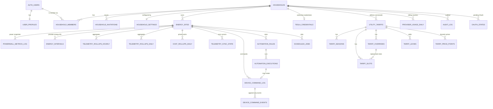

# Database Design (TASK-01)

Status: **PROPOSED, awaiting owner approval.** Written 2026-10-22. TASK-03 implements the schema from this document, TASK-04 adds policies and functions. Table names follow `docs/ai-build-kit/tasks/TASK-03-database-schema.md`; added tables are marked **new**. Decision IDs refer to `docs/DECISIONS.md`.

Conventions: UUID primary keys (`gen_random_uuid()`) except high-volume log tables (bigint identity). Timestamps `timestamptz` in UTC. Money and rates `numeric` with explicit scale. Columns carry units in the name. Migrations `YYYYMMDDHHMMSS_<verb>_<noun>.sql`, never edited after merge. Every table has RLS enabled in the first migration that creates it (default deny); policies come in TASK-04.

## 1. Entities and relationships

Unscoped tables: `job_locks` (named leases), `system_bootstrap` (one row), and
`worker_rate_limit_buckets` (hashed caller/window counters). All are server-only.

## 2. Tables

### 2.1 Identity and tenancy

**user_profiles** `(user_id PK → auth.users ON DELETE CASCADE, display_name text, locale text, created_at)`. Created by an auth trigger (TASK-04). Contains no role.

**households** `(id, name, timezone text, created_at, created_by)`. `timezone` is an IANA name, validated by a trigger against `pg_timezone_names` (a `CHECK` cannot read it). v1 has one row; the schema supports many (D-005).

**household_members** `(household_id → households ON DELETE CASCADE, user_id → auth.users ON DELETE CASCADE, role role_enum NOT NULL, created_at, created_by; PK (household_id, user_id))`. `role_enum = READ_ONLY | READ_WRITE | ADMIN`; no default ADMIN anywhere. Trigger-enforced: no self role change, last-admin protection.

**household_invitations** `(id, household_id, email citext null, role role_enum NOT NULL DEFAULT 'READ_ONLY', token_hash bytea UNIQUE NOT NULL, expires_at, accepted_at, accepted_by, revoked_at, created_by, created_at)`. Token stored only as SHA-256. Index `(household_id)`, partial index on open invitations.

**household_settings** (new) `(household_id PK, monthly_spend_cap_usd numeric(8,2) NOT NULL DEFAULT 9.00 CHECK (>= 0), live_background_interval_minutes int NOT NULL DEFAULT 30 CHECK (>= 5), live_on_demand_min_interval_seconds int NOT NULL DEFAULT 30, on_demand_monthly_allowance int NOT NULL DEFAULT 2000, raw_retention_days int NOT NULL DEFAULT 90 CHECK (>= 7), stale_after_seconds int NOT NULL DEFAULT 3600, automation_paused boolean NOT NULL DEFAULT false, paused_by, paused_at, controls_enabled boolean NOT NULL DEFAULT false, updated_at, updated_by)`. Only ADMIN edits budget/retention/controls; `automation_paused` can be set true by READ_WRITE+ and false only by ADMIN (enforced in DB function). `stale_after_seconds` default must exceed the background interval (CHECK in function) to avoid permanent STALE.

**system_bootstrap** (new) `(id boolean PK DEFAULT true CHECK (id), completed_at, household_id, bootstrap_by_email_hash)`. Single row; used by `private.bootstrap_first_admin`.

### 2.2 Sites and credentials

**energy_sites** `(id, household_id → households ON DELETE CASCADE, provider text NOT NULL CHECK (provider = 'TESLA'), provider_site_id text NOT NULL, name text, timezone text (IANA, trigger-validated), connection_state text CHECK IN ('CONNECTING','LIVE','STALE','ERROR','DISCONNECTED'), capabilities_snapshot jsonb, created_at; UNIQUE (provider, provider_site_id))`. No `DEMO` provider exists in the database (D-017).

**tesla_credentials** `(id, household_id → households ON DELETE CASCADE UNIQUE, key_id text NOT NULL, nonce bytea NOT NULL, ciphertext bytea NOT NULL, version int NOT NULL DEFAULT 1, scopes text[], fleet_api_base_url text NOT NULL, status text CHECK IN ('ACTIVE','NEEDS_REAUTH','REVOKED'), access_expires_at, refresh_issued_at, last_refresh_at, updated_at)`. Ciphertext is AES-256-GCM of `{access_token, refresh_token}`; AAD is `household_id|provider|id|key_id` (`SYSTEM_ARCHITECTURE.md` §8). No grants to `anon`/`authenticated`; RLS on with no policies; only the Worker's secret key reads it.

**oauth_states** (new) `(id, state_hash bytea UNIQUE, household_id, user_id, pkce_verifier_ciphertext bytea, pkce_nonce bytea, expires_at, consumed_at, created_at)`. Single use; rows past `expires_at` purged by the retention job.

### 2.3 Telemetry

**powerwall_metrics_log** (raw power snapshots; bigint identity PK)
| Column | Type | Meaning, unit, sign |
|---|---|---|
| id | bigint identity | PK |
| site_id | uuid → energy_sites ON DELETE CASCADE | |
| sampled_at | timestamptz | Provider timestamp if given, else `received_at`; UTC |
| received_at | timestamptz | When the Worker received it |
| timestamp_origin | text CHECK IN ('PROVIDER','RECEIVED') | Honest origin of `sampled_at` |
| solar_power_w | numeric(12,2) CHECK (>= 0) | Generation, W, ≥ 0 |
| battery_power_w | numeric(12,2) | W, **> 0 discharging, < 0 charging** |
| grid_power_w | numeric(12,2) | W, **> 0 importing, < 0 exporting** |
| load_power_w | numeric(12,2) CHECK (>= 0) | Site load, W, ≥ 0 |
| battery_soc_percent | numeric(5,2) CHECK (BETWEEN 0 AND 100) | State of charge, % |
| grid_status | text | Provider-reported grid state, normalised labels `UNVERIFIED` until observed |
| source | text NOT NULL CHECK (source = 'TESLA') | `DEMO` rejected here |
| quality | text CHECK IN ('OK','PARTIAL','SUSPECT') | `SUSPECT` = balance check failed; excluded from accounting |
Constraints/indexes: `UNIQUE (site_id, sampled_at)`; btree `(site_id, sampled_at DESC)` for range reads. Column comments state the sign convention (TASK-03). No raw provider payload is stored (privacy, rule: no fabrication).

**energy_intervals** (new; provider-reported energy, the base for accounting, D-022)
`(site_id, interval_start timestamptz, interval_end timestamptz CHECK (> interval_start), resolution_seconds int CHECK (> 0), solar_generated_wh, home_consumed_wh, grid_import_wh, grid_export_wh, battery_charged_wh, battery_discharged_wh numeric(14,3) NULL, source CHECK ('TESLA'), quality text CHECK IN ('OK','PARTIAL','SUSPECT','DERIVED') (`DERIVED` = integrated from power snapshots, lower confidence), ingested_at, updated_at; PK (site_id, interval_start, resolution_seconds))`. Which fields Tesla actually returns and at which resolutions is `UNVERIFIED` (TASK-00 Q6); columns are nullable so an unavailable field is stored as NULL, never as zero. Intervals are half-open `[start, end)`.

**telemetry_rollups_hourly** `(site_id, bucket_start timestamptz (UTC hour), same energy columns, sample_count int, covered_seconds int, completeness numeric(5,4) CHECK (BETWEEN 0 AND 1), resolution_seconds_min int, resolution_seconds_max int, computed_at; PK (site_id, bucket_start))`.

**telemetry_rollups_daily** `(site_id, local_date date, timezone text, day_start_utc timestamptz, day_end_utc timestamptz, same energy columns, completeness, resolution_seconds_min/max, computed_at; PK (site_id, local_date))`. A "day" is the site-local calendar day; length is 23, 24 or 25 hours on DST days (`day_end_utc - day_start_utc` stores it).

**cost_rollups_daily** (new, cache) `(site_id, local_date, import_tariff_id, export_tariff_id, currency char(3), import_energy_cost, export_credit, standing_charge, levies, tax, net_cost numeric(18,8), completeness, computed_at; PK (site_id, local_date))`. Derived data, recomputable; deleted and rebuilt for affected dates whenever a tariff version covering those dates changes. Used for ranges beyond raw retention. All values carry the currency; none is silently zero.

**telemetry_sync_state** `(site_id, stream text CHECK IN ('LIVE','HISTORY'), last_attempt_at, last_success_at, last_status CHECK IN ('SUCCESS','PARTIAL','FAILED','SKIPPED'), last_error_code text, cursor jsonb (history: last completed interval end), latest_sample_at, consecutive_failures int; PK (site_id, stream))`.

**provider_usage_daily** (new) `(household_id, usage_day date (UTC), category text CHECK IN ('DATA','COMMAND','WAKE','STREAM','AUTH'), request_count int NOT NULL DEFAULT 0, error_count int NOT NULL DEFAULT 0, PK (household_id, usage_day, category))`. Updated only by `private.record_provider_call(...)`, which atomically records each successful or failed call and returns true when the counter row is inserted or updated. The database function does not enforce the monthly spend cap; budget enforcement remains an unresolved Worker responsibility. Unit prices are Worker configuration, billing category is `UNVERIFIED` (D-023).

**worker_rate_limit_buckets** (new, migration 20261031140000) `(key_hash bytea, window_seconds int, window_started_at timestamptz, hit_count int, expires_at timestamptz; PK (key_hash, window_seconds, window_started_at))`. The worker stores only SHA-256 hashes of caller keys and enforces increments through an atomic, service-role-only RPC. This adapter is not yet wired into the Worker entry point.

### 2.4 Tariffs (decision 10, D-013)

Versioned, effective-dated, one row per **direction** per version. Dates are **site-local calendar dates** in the tariff's own `timezone`, half-open `[effective_from, effective_to)`.

**utility_tariffs** `(id, household_id → households ON DELETE CASCADE, site_id null (null = household default), tariff_key uuid (groups versions of one logical tariff), version int, name, direction text CHECK IN ('IMPORT','EXPORT'), price_mode text CHECK IN ('FLAT','TIME_OF_USE','DYNAMIC'), currency char(3) NOT NULL, timezone text (IANA), effective_from date NOT NULL, effective_to date null CHECK (effective_to > effective_from), tax_mode text CHECK IN ('INCLUSIVE','EXCLUSIVE','NONE'), vat_rate numeric(7,4) null CHECK (vat_rate >= 0), flat_rate_per_kwh numeric(12,6) null CHECK (>= 0), standing_charge_per_day numeric(12,6) null CHECK (>= 0) (IMPORT only), export_payment_model text null CHECK IN ('PER_KWH','NONE') (EXPORT only), created_by, created_at; UNIQUE (tariff_key, version))`. Exclusion constraint (`btree_gist`): no overlapping `daterange(effective_from, effective_to)` for the same `(household_id, site_id, direction)`. Editing a tariff = new version; old versions are immutable once any priced data references them (enforced by trigger on update).

**tariff_seasons** (new) `(id, tariff_id, name, start_month smallint CHECK 1..12, start_day smallint, end_month, end_day)`; inclusive month/day ranges, may wrap the year-end. Absence of seasons means "all year". Overlap/gap validated by the engine (cannot be expressed simply as an exclusion constraint across year wrap); documented as engine-validated.

**tariff_slots** `(id, tariff_id, season_id null, override_id null, day_type text CHECK IN ('ALL','WEEKDAY','WEEKEND'), start_minute smallint CHECK (0..1439), end_minute smallint CHECK (1..1440 AND end_minute > start_minute), rate_per_kwh numeric(12,6) NOT NULL CHECK (>= 0), label text)`. Minutes are local wall-clock minutes after local midnight, half-open `[start, end)`. Exclusion constraint on `(tariff_id, season_id, override_id, day_type)` with `int4range(start_minute, end_minute)` prevents overlaps within one scope; full-day coverage is validated by the engine and by an API-side validate call. Local-time slots (never UTC offsets) are what makes recurring schedules DST-correct (rule 7).

**tariff_overrides** `(id, tariff_id, name, date_from date, date_to date, priority smallint, CHECK (date_to > date_from))`. Date-range replacement of the normal schedule (for example a free-electricity day). Replacement slots reference the override. Equal priority overlapping overrides are rejected by the engine.

**tariff_levies** (new) `(id, tariff_id, name, kind text CHECK IN ('PER_KWH','PER_DAY'), amount numeric(12,6) CHECK (>= 0), taxable boolean NOT NULL)`.

**tariff_price_points** (new, for `DYNAMIC`) `(tariff_id, interval_start timestamptz, interval_end timestamptz, rate_per_kwh numeric(12,6), PRIMARY KEY (tariff_id, interval_start), CHECK (interval_end > interval_start))`; exclusion constraint on `tstzrange(interval_start, interval_end)` per tariff. Half-hourly or any resolution; missing coverage is an error, never a zero price (rule 8).

Precedence and arithmetic: `docs/ENERGY_ACCOUNTING.md` §5. Irish rates in seeds or fixtures are labelled `ILLUSTRATIVE EXAMPLE` only.

### 2.5 Commands (decision 12, D-015)

**device_command_log** `(id, household_id, site_id, requested_by uuid null, origin text CHECK IN ('USER','AUTOMATION'), automation_execution_id null, kind text NOT NULL CHECK IN (list of DOCUMENTED kinds), params jsonb NOT NULL, params_hash bytea NOT NULL, idempotency_key text NOT NULL, provider_mode text CHECK IN ('MOCK','TESLA'), state text NOT NULL CHECK IN ('PENDING','CONFIRMED','FAILED','UNKNOWN') DEFAULT 'PENDING', phase text CHECK IN ('RECORDED','DISPATCHING','DISPATCHED','RECONCILING','DONE'), requested_at, dispatched_at, finished_at, error_code text, provider_http_status int, result jsonb, UNIQUE (site_id, idempotency_key))`. The initial row is inserted **user-scoped** (RLS proves the role) **before** any dispatch; replay of the same key with the same `params_hash` returns the stored result, a different hash returns 409. `kind` values are limited to capabilities TASK-00 marked `DOCUMENTED`; adding one needs a migration and a `DECISIONS.md` entry. `NOT_SUPPORTED` kinds (forced charge, forced export, solar bypass, islanding) are not representable.

**device_command_events** (new, append-only) `(id bigint identity, command_id, at timestamptz, from_state, to_state, phase, detail jsonb)`. No `UPDATE`/`DELETE` grants; trigger rejects changes.

### 2.6 Automation (TASK-18)

**automation_rules** `(id, household_id, site_id, name, mode text NOT NULL DEFAULT 'DISABLED' CHECK IN ('DISABLED','DRY_RUN','ACTIVE'), priority int NOT NULL, definition jsonb NOT NULL, definition_version int NOT NULL, version bigint NOT NULL DEFAULT 1, created_by, updated_by, created_at, updated_at)`. Only ADMIN may set `ACTIVE` (DB function); `READ_WRITE` may set `DISABLED`/`DRY_RUN`.

**automation_executions** `(id, rule_id, site_id, scheduled_slot timestamptz, evaluated_at, mode_at_evaluation, decision text CHECK IN ('WOULD_ACT','ACTED','NO_ACTION','SKIPPED_STALE','SKIPPED_PAUSED','SKIPPED_CAPABILITY','SKIPPED_CONFLICT','SKIPPED_MISSED','ERROR'), reason text, command_id null, UNIQUE (rule_id, scheduled_slot))`. The unique key makes duplicate cron delivery harmless; the idempotency key for the command is derived from `(rule_id, site_id, scheduled_slot)`.

### 2.7 Jobs, locks, audit

**scheduled_jobs** (new) `(id, kind text, site_id null, dedupe_key text UNIQUE NOT NULL, run_at timestamptz, state text CHECK IN ('QUEUED','RUNNING','DONE','FAILED','DEAD'), attempts int, max_attempts int, lease_expires_at timestamptz, locked_by text, payload jsonb (no secrets), last_error text (sanitised), created_at, finished_at)`. Index `(state, run_at)`; partial index on `state = 'QUEUED'`. Kinds: `token_maintenance`, `sync_live`, `sync_history`, `rollup`, `retention`, `evaluate_rules`, `reconcile_command`, `reencrypt_credentials`.

Migration `20261031140000_expose_durable_job_api.sql` adds narrowly scoped `public.worker_*` PostgREST wrappers while leaving `private` unexposed. All execute grants are service-role-only. `worker_schedule_due_jobs` creates bounded recurring slots and rotates capped pages to avoid permanent starvation in a shared-hosting deployment. `worker_enqueue_job` verifies site/household consistency. Claim uses the hardened `private.claim_jobs`; completion/failure is bound to `locked_by`. Durable Worker handlers are still pending because the application repository and encrypted token adapters are not implemented; therefore staging and production cron remain disabled.

**job_locks** `(key text PK, owner text NOT NULL, lease_expires_at timestamptz NOT NULL)`. Named short leases (`token:<household>`, `fetch:live:<site>`).

**audit_log** `(id bigint identity, household_id null, actor_type text CHECK IN ('USER','SYSTEM'), actor_user_id null, action text NOT NULL, target_type text, target_id text, metadata jsonb, request_id text, created_at)`. Append-only (no update/delete grants; trigger rejects). `metadata` is written through an allowlist per action and never contains tokens, JWTs or telemetry. Actions include `member.role_changed`, `member.removed`, `invitation.created/accepted/revoked`, `bootstrap.completed`, `tesla.connected/disconnected/reauth_needed`, `command.requested/confirmed/failed/unknown`, `rule.mode_changed`, `automation.paused/resumed`, `tariff.version_created`, `settings.changed`, `data.exported`, `data.deleted`.

## 3. Functions and triggers (TASK-04 unless stated)

| Name | Purpose | Callable by |
|---|---|---|
| `private.is_member(household_id)` | membership check for policies | policies (definer, fixed search_path) |
| `private.has_role_at_least(household_id, role)` | role check for policies | policies |
| `private.handle_new_user()` trigger | create `user_profiles`, never a role | auth trigger |
| `private.bootstrap_first_admin(...)` | one-time first household + ADMIN | trusted server role only |
| `public.create_invitation(...)`, `accept_invitation(token)` | invitation lifecycle | ADMIN / authenticated invitee |
| `public.change_member_role(...)`, `remove_member(...)` | audited, admin-only, no self, last-admin guard | ADMIN |
| `public.set_automation_paused(paused)` | pause by READ_WRITE+, resume ADMIN only | members |
| `public.set_rule_mode(rule_id, mode)` | `ACTIVE` only for ADMIN | READ_WRITE+ |
| `private.claim_jobs(worker_id, max, lease_s)` | atomic claim with `FOR UPDATE SKIP LOCKED` (TASK-16/18 add handlers) | service role only |
| `private.acquire_lock(key, owner, lease_s)`, `release_lock(...)` | lease locks via `INSERT … ON CONFLICT … WHERE lease_expires_at < now()` | service role only |
| `private.record_provider_call(household, category, ok)` | atomically increments usage counters; returns whether a counter row was written | service role only |
| `private.touch_audit(...)` | allowlisted audit insert | definer functions, service role |
| triggers | last-admin, no-self-role-change, append-only tables, tariff version immutability, IANA timezone validation, `source = 'TESLA'` | n/a |

Every `SECURITY DEFINER` function: `SET search_path = ''`, schema-qualified names, `REVOKE EXECUTE … FROM PUBLIC`, explicit `GRANT` (V10). `private` schema is not exposed through the API.

Which task creates what: **TASK-03** all tables, constraints, indexes, RLS enabled/default deny, local seed; **TASK-04** policies, grants, functions above (except job functions), triggers, tests; **TASK-16** the job/lock/usage functions and any ingestion migration refinements; **TASK-17/18** may add migrations for command and automation functions. The job and lock *tables* exist from TASK-03 so Task 04 can lock them down.

## 4. Telemetry storage, retention, partitioning, indexes (decision 8, D-011)

**Volumes** (per site): one raw snapshot every 5 minutes is about 105,000 rows per year; the default 30-minute background cadence plus on-demand polls is about 20,000 to 30,000 rows per year; `energy_intervals` at 5-minute resolution (if Tesla provides it, `UNVERIFIED`) is about 105,000 rows per year. These are small for Postgres.

**Partitioning: none in v1.** Revisit if a site exceeds about 10 million rows in any table or if retention deletes become slow. Rationale: simplicity, constraints and unique keys work without partition-key restrictions. Recorded in `DECISIONS.md` D-011.

**Indexes:** unique keys above double as the main range index `(site_id, time)`. Rollups are keyed `(site_id, bucket/local_date)`. Job claim uses `(state, run_at)`. No GIN indexes on jsonb unless a query needs one.

**Rollups:** hourly (UTC) and daily (site-local day) energy rollups are rebuilt from `energy_intervals` (or from `OK` snapshots, flagged lower quality) for each touched day, never incremented, so late and duplicate data converge. They record `completeness` and the real min/max resolution (rule 9). Cost is **not** stored in energy rollups because tariffs change; priced results are computed by `packages/domain`, with `cost_rollups_daily` as a recomputable cache for long ranges.

**Retention defaults** (configurable by ADMIN within the documented minimums; owner to confirm, Q-07):
| Data | Default | Action |
|---|---|---|
| `powerwall_metrics_log` raw snapshots | 90 days | batched delete after rollups exist |
| `energy_intervals` | 800 days | batched delete after daily rollups and cost rollups exist |
| hourly rollups | 800 days | batched delete |
| daily rollups, `cost_rollups_daily` | until household data deletion | keep |
| `device_command_log`, events | 24 months | batched delete, audit row written |
| `audit_log` | 24 months | batched delete |
| `scheduled_jobs` finished | 30 days | batched delete |
| `oauth_states`, expired invitations | 7 days after expiry | delete |

Retention runs as a job: dry-run report first, then batched deletes of at most a fixed number of rows per tick to respect Worker limits (V3).

## 5. Data dictionary summary (units and signs)

Authoritative statement: `docs/ENERGY_ACCOUNTING.md` §2. Column names carry units (`..._w`, `..._wh`, `..._percent`, `..._per_kwh`, `..._usd` only for the Tesla spend cap). Money: `numeric`, always with a `currency` column on the same row or via the tariff; serialised as strings.

## 6. Privacy hooks in the schema

User deletion: `auth.users` delete cascades `user_profiles` and `household_members`; `audit_log.actor_user_id` is set to NULL and `metadata` carries no PII, so the log survives without identifying the user. Household deletion cascades all site, telemetry, tariff, command and automation data; `audit_log` rows for the household are deleted last. Details in `docs/PRIVACY.md`.
