# Database ER Diagram and Units

Status: **created in TASK-03**; matches `supabase/migrations/` as applied by `npm run db:verify`. Column-level detail (types, nullability, defaults, comments) is in the generated [`DATABASE_DICTIONARY.md`](DATABASE_DICTIONARY.md). Design rationale: [`DATABASE_DESIGN.md`](DATABASE_DESIGN.md).

## Entity relationships

```mermaid
erDiagram
  AUTH_USERS ||--|| USER_PROFILES : "has"
  HOUSEHOLDS ||--o{ HOUSEHOLD_MEMBERS : "has (role lives here)"
  AUTH_USERS ||--o{ HOUSEHOLD_MEMBERS : "is member via"
  HOUSEHOLDS ||--o{ HOUSEHOLD_INVITATIONS : "issues"
  HOUSEHOLDS ||--o| HOUSEHOLD_SETTINGS : "configured by"
  HOUSEHOLDS ||--o| SYSTEM_BOOTSTRAP : "marked by (one row system-wide)"
  HOUSEHOLDS ||--o{ ENERGY_SITES : "owns"
  HOUSEHOLDS ||--o| TESLA_CREDENTIALS : "authorises (ciphertext only)"
  HOUSEHOLDS ||--o{ OAUTH_STATES : "pending OAuth"
  HOUSEHOLDS ||--o{ PROVIDER_USAGE_DAILY : "billing counters"
  HOUSEHOLDS ||--o{ UTILITY_TARIFFS : "defines (versioned)"
  HOUSEHOLDS ||--o{ AUDIT_LOG : "audited"
  HOUSEHOLDS ||--o{ SCHEDULED_JOBS : "household jobs"
  ENERGY_SITES ||--o{ POWERWALL_METRICS_LOG : "power snapshots"
  ENERGY_SITES ||--o{ ENERGY_INTERVALS : "provider energy Wh"
  ENERGY_SITES ||--o{ TELEMETRY_ROLLUPS_HOURLY : "aggregates"
  ENERGY_SITES ||--o{ TELEMETRY_ROLLUPS_DAILY : "aggregates"
  ENERGY_SITES ||--o{ COST_ROLLUPS_DAILY : "priced cache"
  ENERGY_SITES ||--o{ TELEMETRY_SYNC_STATE : "sync cursors"
  ENERGY_SITES ||--o{ SCHEDULED_JOBS : "site jobs"
  ENERGY_SITES ||--o{ UTILITY_TARIFFS : "site-specific tariff (optional)"
  UTILITY_TARIFFS ||--o{ TARIFF_SEASONS : "has"
  UTILITY_TARIFFS ||--o{ TARIFF_SLOTS : "has"
  UTILITY_TARIFFS ||--o{ TARIFF_OVERRIDES : "has"
  UTILITY_TARIFFS ||--o{ TARIFF_LEVIES : "adds"
  UTILITY_TARIFFS ||--o{ TARIFF_PRICE_POINTS : "dynamic prices"
  TARIFF_SEASONS ||--o{ TARIFF_SLOTS : "scopes"
  TARIFF_OVERRIDES ||--o{ TARIFF_SLOTS : "replacement slots"
  ENERGY_SITES ||--o{ DEVICE_COMMAND_LOG : "commands"
  DEVICE_COMMAND_LOG ||--o{ DEVICE_COMMAND_EVENTS : "append-only events"
  ENERGY_SITES ||--o{ AUTOMATION_RULES : "rules"
  AUTOMATION_RULES ||--o{ AUTOMATION_EXECUTIONS : "runs"
  AUTOMATION_EXECUTIONS ||--o| DEVICE_COMMAND_LOG : "may create"
  JOB_LOCKS {
    text key PK
  }
```

`AUTH_USERS` is Supabase's `auth.users` (not created by these migrations). `JOB_LOCKS` stands alone: named short leases with no foreign keys.

**Tenancy integrity.** Child tables that carry both `household_id` and `site_id` use a composite foreign key `(site_id, household_id) -> energy_sites (id, household_id)`, so a command, rule or site-specific tariff cannot name a site of another household. Tariff slots reference a season or an override with `(season_id, tariff_id)` or `(override_id, tariff_id)`, so they cannot cross tariffs. Executions reference `(rule_id, site_id)`.

## Delete behaviour
| Deleting | Effect |
|---|---|
| a household | cascades members, invitations, settings, sites (and their telemetry, rollups, commands, events, rules, executions), credentials, OAuth states, usage counters, tariffs (and children), jobs and audit rows |
| a site | cascades its telemetry, rollups, sync state, commands, events, rules, executions, jobs and site-specific tariffs |
| an auth user | cascades their profile, memberships and pending OAuth states; `created_by`, `updated_by`, `requested_by`, `accepted_by` and `audit_log.actor_user_id` become NULL; audit rows are kept |
| a command | cascades its events; `automation_executions.command_id` becomes NULL |
| a tariff | `cost_rollups_daily` references become NULL; the cache rows stay and can be rebuilt |

## Units and signs (summary)
Authoritative statement: [`ENERGY_ACCOUNTING.md`](ENERGY_ACCOUNTING.md) section 2. These are the only conventions used in column names and comments.

| Quantity | Column pattern | Unit | Sign or range |
|---|---|---|---|
| Solar power | `solar_power_w` | W | >= 0 |
| Battery power | `battery_power_w` | W | **> 0 discharging, < 0 charging** |
| Grid power | `grid_power_w` | W | **> 0 importing, < 0 exporting** |
| Load power | `load_power_w` | W | >= 0 |
| Battery state of charge | `battery_soc_percent` | percent | 0 to 100 |
| Energy per interval or bucket | `solar_generated_wh`, `home_consumed_wh`, `grid_import_wh`, `grid_export_wh`, `battery_charged_wh`, `battery_discharged_wh` | Wh | >= 0 (directional); NULL = not provided, never zero |
| Durations | `resolution_seconds`, `covered_seconds`, `stale_after_seconds`, `*_seconds` | s | > 0 or >= 0 as constrained |
| Rates | `rate_per_kwh`, `flat_rate_per_kwh`, `amount` (levies) | currency per kWh or per day | `numeric(12,6)`, >= 0, never float |
| Standing charge | `standing_charge_per_day` | currency per local day | `numeric(12,6)`, >= 0 |
| Cached money | `import_energy_cost`, `export_credit`, `standing_charge`, `levies`, `tax`, `net_cost` | currency of the row | `numeric(18,8)`, unrounded; NULL = not priceable; `net_cost` > 0 is a cost, < 0 a credit |
| Spend cap | `monthly_spend_cap_usd` | USD | `numeric(8,2)`, >= 0 (Tesla billing estimate, not a tariff) |
| Completeness | `completeness` | fraction | 0 to 1 |
| Local clock times in tariffs | `start_minute`, `end_minute` | minutes after local midnight | `[start, end)`, 0 to 1440 |
| Times | all `*_at`, `interval_*`, `day_*_utc` | UTC `timestamptz` | half-open intervals `[start, end)` |
| Dates | `local_date`, `effective_from`, `effective_to`, `date_from`, `date_to` | calendar date in the row's IANA `timezone` | half-open `[from, to)` |

Native Tesla signs and field names are `UNVERIFIED` (TASK-00); the Worker normalises to this convention before inserting.
