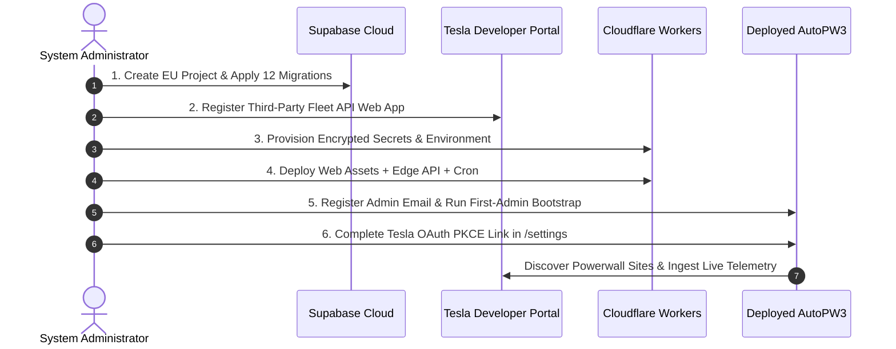

# AutoPW3 — Comprehensive Installation and Operations Guide

This guide provides end-to-end instructions for deploying, configuring, and operating **AutoPW3** across both **Local Test / Development Environments** and **Live Production Environments**.

---

## 1. Architectural Overview & Environment Matrix

AutoPW3 is designed around strict separation between **Demo / Test** execution and **Live Production** execution (Rule 5 & Decision D-017).

```mermaid
flowchart TB
    subgraph Local_Test_Environment ["Local Test / Development Environment (Zero Credentials)"]
        direction TB
        ViteDev["Vite Dev Server (Port 5173)<br/>VITE_DEMO_MODE=true<br/>VITE_AUTH_MODE=mock"]
        LocalWorker["Wrangler Dev (Port 8787)<br/>ENVIRONMENT=local<br/>MockTeslaClient + InMemoryRepository"]
        SyntheticEngine["In-Memory Simulation<br/>Synthetic Physics & Rollups"]
        PlaywrightE2E["Playwright Test Suite<br/>Headless Chromium Smoke Tests"]
    end

    subgraph Production_Live_Environment ["Production Live Environment (Cloud Infrastructure)"]
        direction TB
        CF_Worker["Cloudflare Edge Worker (autopw3)<br/>Static Assets + /api/v1 + Cron Trigger"]
        Supa_Auth["Supabase Auth (PKCE)<br/>JWT Verification via Asymmetric JWKS"]
        Supa_DB[("PostgreSQL 17 Database<br/>29 Tables + 52 RLS Security Policies")]
        Tesla_Fleet["Tesla Fleet API (Regional Base URL)<br/>Live Telemetry + Interval History + Commands"]
    end
```



### Environment Comparison

| Dimension | Local Test / Development | Production Live Deployment |
| :--- | :--- | :--- |
| **Frontend Serving** | Vite Dev Server (`http://localhost:5173`) | Cloudflare Worker Static Assets (`https://<custom-domain>`) |
| **API & Backend** | Wrangler Dev (`http://localhost:8787`) | Cloudflare Edge Worker (`https://<custom-domain>/api/v1/*`) |
| **Background Cron** | Manual invocation via HTTP endpoint | Cloudflare Cron Trigger (`* * * * *` every minute) |
| **Authentication** | Synthetic in-memory mock client | Supabase Auth (Email/Password, PKCE, confirmed emails) |
| **Database Persistence** | `InMemoryRepository` pre-seeded with fixtures | Supabase PostgreSQL 17 with strict Row-Level Security |
| **Tesla Integration** | `MockTeslaClient` (deterministic physics engine) | `TeslaClient` talking directly to Tesla Fleet API |
| **Secret Management** | None required (uses zero-secret fallbacks) | Cloudflare Worker Secrets (`wrangler secret put`) |
| **Data Tagging** | Tagged `source: "DEMO"`, never reaches DB | Tagged `source: "TESLA"`, validated by database CHECK |

---

## 2. Prerequisites & Machine Setup

### Hardware & Operating System
- **Operating System:** Windows 10/11, macOS (Apple Silicon or Intel), or Linux (Ubuntu 22.04+ recommended).
- **RAM:** Minimum 8 GB (16 GB recommended for concurrent test suites).
- **Disk Space:** 2 GB free disk space.

### Software Dependencies
1. **Node.js**: `v22.0.0` or newer (Node 22 LTS or Node 24 LTS).
   ```bash
   node -v
   # Must output >= v22.0.0
   ```
2. **npm**: `v10.0.0` or newer.
   ```bash
   npm -v
   # Must output >= 10.0.0
   ```
3. **Git**: `v2.40.0` or newer.
   ```bash
   git --version
   ```
4. **Docker Desktop** *(Optional — only required if running local throwaway PostgreSQL for `npm run db:test` or `npm run db:verify`)*.

---

## 3. Part 1: Local Test & Development Environment

In this mode, you can inspect, test, and develop the entire application without any cloud accounts or Tesla hardware.

### 3.1 Step 1: Clone the Codebase & Install Dependencies

```bash
# Clone the repository
git clone https://github.com/inalasai/AutoPW3.git
cd AutoPW3

# Clean installation from lockfile to guarantee exact dependencies
npm ci
```

### 3.2 Step 2: Run Verification & Test Suites

AutoPW3 includes 1,052 automated tests and comprehensive architecture rules. Execute the verification pipeline:

```bash
# 1. Typecheck: strict TypeScript compilation across all packages and e2e
npm run typecheck

# 2. Linting: ESLint + custom architecture rule validation + Prettier check
npm run lint

# 3. Automated Tests: 678 tests across shared, domain, web, and worker
npm test

# 4. Secret Scan: Secretlint scan ensuring no credentials exist in the repo
npm run secrets:scan

# 5. Production Dry-Run Build: Vite web bundling + Wrangler bundle verification
npm run build
```

> [!TIP]
> **One-Command Health Check:** Run `npm run check` to execute steps 1 through 5 in sequence.

### 3.3 Step 3: Run the Local Web Application in Demo Mode

Start the interactive frontend development server:

```bash
npm run dev
```

- **URL:** Open [http://localhost:5173](http://localhost:5173) in any browser.
- **Features Active in Demo Mode:**
  - **Live Energy Flow View:** Canvas-based interactive particle animation rendering synthetic solar generation, battery charging/discharging, and grid exchange.
  - **Tariff Manager:** Time-of-use schedule editor with effective-dated versions and real-time gap validation.
  - **Analytics Engine:** Multi-resolution energy and financial charts (15-minute, hourly, daily, monthly) with synthetic cost calculations.
  - **Automation Manager:** Rule creation, priority assignment, time windows, and condition evaluation.
  - **Demo Banner:** Persistent indicator stating that the application is running in demonstration mode.

### 3.4 Step 4: Run the Local Cloudflare Worker API

To test the backend API and background workflows locally:

```bash
# Terminal 1: Build the web assets so the worker can mount them
npm run build -w @autopw3/web

# Terminal 2: Start Wrangler local server
npm run dev:worker
```

- **URL:** [http://localhost:8787](http://localhost:8787)
- **API Health Check:**
  ```bash
  curl -i http://localhost:8787/api/v1/health
  # Expected: HTTP 200 {"status":"ok","environment":"local"}
  ```
- **Trigger Background Cron Ingestion Manually:**
  In local development, Cloudflare's minute-by-minute cron does not fire automatically. You can trigger a full cron evaluation cycle at any time:
  ```bash
  curl -i "http://localhost:8787/cdn-cgi/local/scheduled"
  ```
  This executes:
  1. Token maintenance & expiry check
  2. Multi-site discovery
  3. Live status normalization
  4. Historical interval backfill
  5. Rollup recomputations
  6. Tariff-aware automation evaluation
  7. Data retention cleanup

### 3.5 Step 5: Run Playwright E2E Browser Smoke Tests

AutoPW3 features end-to-end browser automation testing authentication, routing, and UI responsiveness:

```bash
# Install the browser binary (one-time setup)
npx playwright install chromium

# Run all 38 Playwright E2E smoke tests
npm run test:e2e
```

### 3.6 Step 6: Run Local Database SQL Security Tests (Optional)

If Docker is running on your machine, you can run the pgTAP SQL test suite against a throwaway PostgreSQL 17 container:

```bash
# Runs 336 pgTAP assertions verifying RLS, bootstrap lock, roles, and triggers
npm run db:test
```

---

## 4. Part 2: Production Live Environment Setup

Follow these steps to deploy AutoPW3 to production with real Tesla Powerwall hardware and dedicated cloud infrastructure.



---

### Step 1: Provision Supabase Database & Auth

1. **Create Project:**
   - Log in to the [Supabase Dashboard](https://supabase.com/dashboard).
   - Create a new organization and project.
   - **Critical Region Selection:** Select an EU region (e.g., Frankfurt `eu-central-1` or London `eu-west-2`) to satisfy GDPR requirements for residential power and financial records.
2. **Retrieve API Keys:**
   Navigate to **Project Settings -> API** and copy:
   - `Project URL`: `https://<project-ref>.supabase.co`
   - `anon public key`: `eyJhbGciOi...` (Safe for browser client)
   - `service_role secret key`: `eyJhbGciOi...` (Keep confidential; Cloudflare Worker secret)
3. **Apply Database Migrations:**
   Ensure you have the Supabase CLI installed, then link and push the schema:
   ```bash
   # Link local repo to your remote project
   npx supabase link --project-ref <project-ref>

   # Push all 12 migrations in numerical sequence
   npx supabase db push
   ```
   *Verification:* In Supabase Table Editor, verify that all 29 tables exist with Row-Level Security (RLS) enabled. Specifically verify that `tesla_credentials` and `oauth_states` have 0 policies granted to `anon` or `authenticated`.
4. **Configure Authentication:**
   In **Authentication -> Configuration**:
   - **Email Provider:** Enable Email / Password signup.
   - **Confirm Email:** Turn ON (`requireConfirmation = true`).
   - **Password Security:** Set minimum password length to 12 characters, requiring numbers and symbols.
   - **Site URL:** `https://autopw3.yourdomain.com`
   - **Redirect URLs:** Add:
     - `https://autopw3.yourdomain.com/auth/callback`
     - `https://autopw3.yourdomain.com/reset-password`
     - `https://autopw3.yourdomain.com/invite/*`

---

### Step 2: Register Tesla Fleet API Application

1. Log in to the [Tesla Developer Portal](https://developer.tesla.com/).
2. Create an Application for AutoPW3:
   - **Application Type:** Web Application (Third-Party Authorization Code Flow with PKCE).
   - **Allowed Scopes:**
     - `openid`
     - `offline_access`
     - `energy_device_data` (Read live telemetry, power samples, and site information)
     - `energy_cmds` (Required for automation commands: backup reserve, operation modes)
   - **Allowed Redirect URI:**
     - `https://autopw3.yourdomain.com/api/v1/tesla/callback`
3. Securely record:
   - `Client ID` (`TESLA_CLIENT_ID`)
   - `Client Secret` (`TESLA_CLIENT_SECRET`)

---

### Step 3: Configure & Deploy Cloudflare Worker

1. **Authenticate Wrangler CLI:**
   ```bash
   npx wrangler login
   ```
2. **Provision Encrypted Secrets:**
   Inside `apps/worker`, securely inject credentials into Cloudflare's KMS:
   ```bash
   cd apps/worker

   # 1. Supabase Service Role Key
   npx wrangler secret put SUPABASE_SECRET_KEY

   # 2. Master AES-256-GCM Token Encryption Key (Generate 32 random bytes)
   # Windows PowerShell:
   # [Convert]::ToHexString((1..32 | ForEach-Object { Get-Random -Minimum 0 -Maximum 256 }))
   # macOS / Linux:
   # openssl rand -hex 32
   npx wrangler secret put TOKEN_ENCRYPTION_KEY

   # 3. Tesla Fleet API Client Secret
   npx wrangler secret put TESLA_CLIENT_SECRET
   ```

3. **Configure Environment Variables in `apps/worker/wrangler.jsonc`:**
   Update the non-secret configuration variables:
   ```jsonc
   {
     "$schema": "node_modules/wrangler/config-schema.json",
     "name": "autopw3",
     "main": "src/index.ts",
     "compatibility_date": "2026-10-01",
     "assets": {
       "directory": "../web/dist",
       "binding": "ASSETS",
       "not_found_handling": "single-page-application",
       "run_worker_first": ["/api/*"]
     },
     "triggers": {
       "crons": ["* * * * *"]
     },
     "vars": {
       "ENVIRONMENT": "production",
       "PROVIDER_MODE": "live",
       "SUPABASE_URL": "https://<your-project-ref>.supabase.co",
       "SUPABASE_ANON_KEY": "<your-anon-public-key>",
       "TESLA_CLIENT_ID": "<your-tesla-client-id>",
       "TESLA_REDIRECT_URI": "https://autopw3.yourdomain.com/api/v1/tesla/callback",
       "ALLOWED_ORIGINS": "https://autopw3.yourdomain.com"
     }
   }
   ```

4. **Configure Frontend Production Environment:**
   Create or edit `apps/web/.env.production`:
   ```ini
   VITE_DEMO_MODE=false
   VITE_AUTH_MODE=supabase
   VITE_SUPABASE_URL=https://<your-project-ref>.supabase.co
   VITE_SUPABASE_ANON_KEY=<your-anon-public-key>
   VITE_API_BASE_URL=https://autopw3.yourdomain.com
   ```

5. **Build and Deploy:**
   From the repository root:
   ```bash
   # 1. Build optimized web bundle with strict CSP
   npm run build -w @autopw3/web

   # 2. Deploy Worker and static assets to Cloudflare
   cd apps/worker
   npx wrangler deploy
   ```

---

### Step 4: First-Admin Bootstrap & Hardware Activation

1. **Register the Owner Account:**
   - Open `https://autopw3.yourdomain.com/register` in your web browser.
   - Enter your email address and a strong password (12+ characters).
   - Check your email inbox and click the verification link from Supabase.
2. **Execute First-Admin Bootstrap Procedure:**
   To guarantee single-owner tenancy without race conditions:
   - Record the owner's confirmed email address (`<owner-email>`). The bootstrap function looks up the user by confirmed email.
   - Open **Supabase Dashboard -> SQL Editor** and execute:
     ```sql
     SELECT private.bootstrap_first_admin(
       '<owner-email>',
       'My Home Powerwall',
       'Europe/Dublin' -- Set to your local IANA timezone
     );
     ```
   - Verify that `system_bootstrap` contains exactly one row. Any subsequent attempt to call `bootstrap_first_admin` will immediately abort with an exception.
3. **Log In and Link Tesla Powerwall:**
   - Return to `https://autopw3.yourdomain.com/login` and log in.
   - Navigate to **Settings** (`/settings`).
   - Click **Connect Tesla Account**.
   - Complete authentication in the Tesla OAuth dialog.
   - Upon redirect, AutoPW3 queries Tesla Fleet API, discovers your energy site ID, creates your site record, and immediately initializes background ingestion!

---

## 5. Part 3: Operational Verification & Health Checks

Once deployed, execute these verification checks:

### 1. API Health Check
```bash
curl -i https://autopw3.yourdomain.com/api/v1/health
```
**Expected Response:**
```http
HTTP/2 200
content-type: application/json
x-request-id: <uuid>

{"status":"ok","environment":"production"}
```

### 2. Security Headers & CSP Audit
```bash
curl -I https://autopw3.yourdomain.com/
```
Verify the following headers are present:
- `Content-Security-Policy`: Disallows inline scripts/styles; allows connect-src only to your Supabase and Worker domains.
- `X-Frame-Options: DENY`: Blocks clickjacking.
- `X-Content-Type-Options: nosniff`: Prevents MIME-type sniffing.
- `Referrer-Policy: strict-origin-when-cross-origin`

### 3. Verification Checklist in UI

- [ ] **Live Telemetry:** Open `/live`. Power readings update every 30 seconds (on-demand) and every 5 minutes (background).
- [ ] **Sign Conventions:**
  - Solar generation is $\ge 0\text{ W}$.
  - Battery discharging is $> 0\text{ W}$; charging is $< 0\text{ W}$.
  - Grid import is $> 0\text{ W}$; export is $< 0\text{ W}$.
- [ ] **Automation Rules:**
  - Create a new test rule in `/automation`.
  - Confirm the rule initializes in `DRY_RUN` mode.
  - Review the execution history log: verify it outputs `WOULD_ACT` without sending real hardware commands.
  - Once verified, promote the rule to `ACTIVE`.
- [ ] **Emergency Pause:** Toggle the Emergency Pause switch in `/controls` or `/automation`. Confirm all background command execution immediately suspends.

---

## 6. Part 4: Troubleshooting & Maintenance

### 6.1 Common Operational Scenarios

| Issue | Root Cause | Resolution |
| :--- | :--- | :--- |
| **`400 VALIDATION_FAILED: Invalid or expired OAuth state`** | State token TTL (10m) expired before OAuth completion or browser CSRF mismatch. | Restart the connection flow from `/settings`. |
| **`401 UNAUTHORIZED / NEEDS_REAUTH`** | Tesla refresh token was revoked in Tesla mobile app or expired. | In `/settings`, click **Reconnect Tesla Account** to re-authorize. |
| **`429 RATE_LIMITED`** | Exceeded Tesla Fleet API tier quota. | System automatically backs off based on `Retry-After`. Ensure spend cap is configured in settings. |
| **Telemetry status shows `STALE`** | Tesla Powerwall gateway is offline or disconnected from home Wi-Fi. | Powerwall gateway offline. Telemetry older than 300s is marked `STALE` and automations are halted for safety. |
| **Command state remains `UNKNOWN`** | D-015 read-back reconciliation mismatch. | Command was received by Tesla API, but physical device query did not reflect the new setting within timeout. Inspect Powerwall grid status. |

### 6.2 Secret Rotation Procedure

If you need to rotate secrets:
```bash
cd apps/worker

# Rotate Tesla Client Secret:
npx wrangler secret put TESLA_CLIENT_SECRET

# Rotate Token Encryption Key:
# 1. Generate new 32-byte hex key
# 2. Update secret in Cloudflare:
npx wrangler secret put TOKEN_ENCRYPTION_KEY
```

### 6.3 Backup and Disaster Recovery

To perform a point-in-time backup of the Supabase PostgreSQL database:

```bash
# Export schema and data (requires Supabase connection string)
pg_dump "$SUPABASE_DB_URL" --format=custom --file=autopw3_backup_$(date +%Y%m%d).dump

# Restore into a recovery database
pg_restore --clean --if-exists --no-owner --dbname="$RECOVERY_DB_URL" autopw3_backup_20261026.dump
```
*(Reference: [docs/RECOVERY_GUIDE.md](file:///d:/AI_Apps/AutoPW3/AutoPW3/docs/RECOVERY_GUIDE.md))*

---

## 7. Operational Document Cross-Reference

- [docs/DEVELOPMENT_SETUP.md](file:///d:/AI_Apps/AutoPW3/AutoPW3/docs/DEVELOPMENT_SETUP.md) — Local scripts, testing commands, and architecture rules.
- [docs/DEPLOYMENT_RUNBOOK.md](file:///d:/AI_Apps/AutoPW3/AutoPW3/docs/DEPLOYMENT_RUNBOOK.md) — Production Cloudflare Workers and Supabase deployment runbook.
- [docs/SECURITY_MODEL.md](file:///d:/AI_Apps/AutoPW3/AutoPW3/docs/SECURITY_MODEL.md) — Security boundaries, encryption at rest, and RLS policies.
- [docs/DEVICE_CONTROL_SAFETY.md](file:///d:/AI_Apps/AutoPW3/AutoPW3/docs/DEVICE_CONTROL_SAFETY.md) — Safety barriers, forbidden commands, and D-015 read-back reconciliation.
- [docs/CREDENTIALS.md](file:///d:/AI_Apps/AutoPW3/AutoPW3/docs/CREDENTIALS.md) — Secret handling rules and variable documentation.
