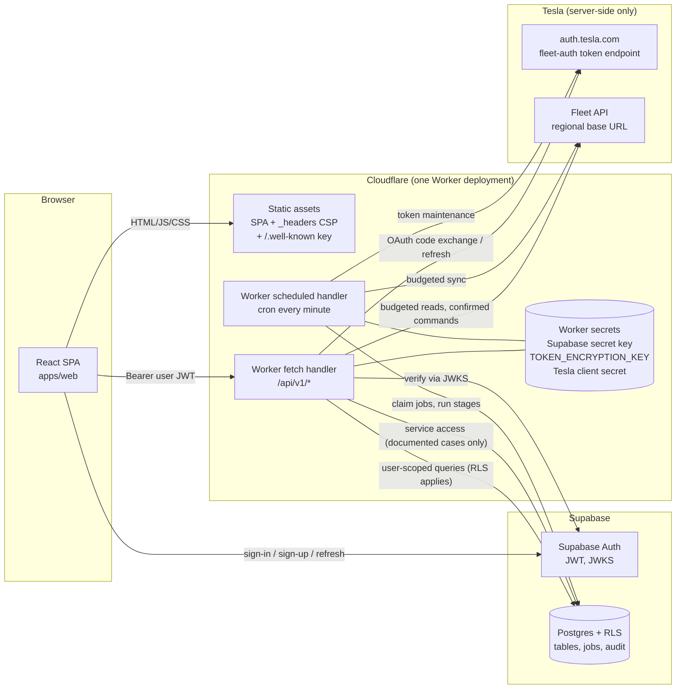
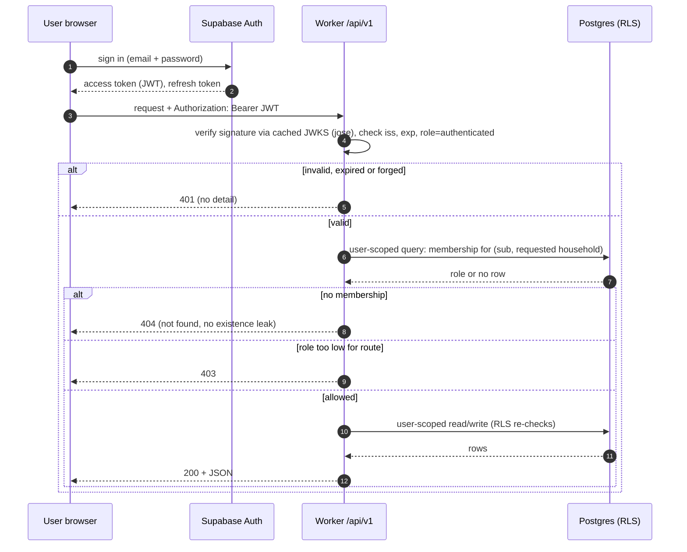
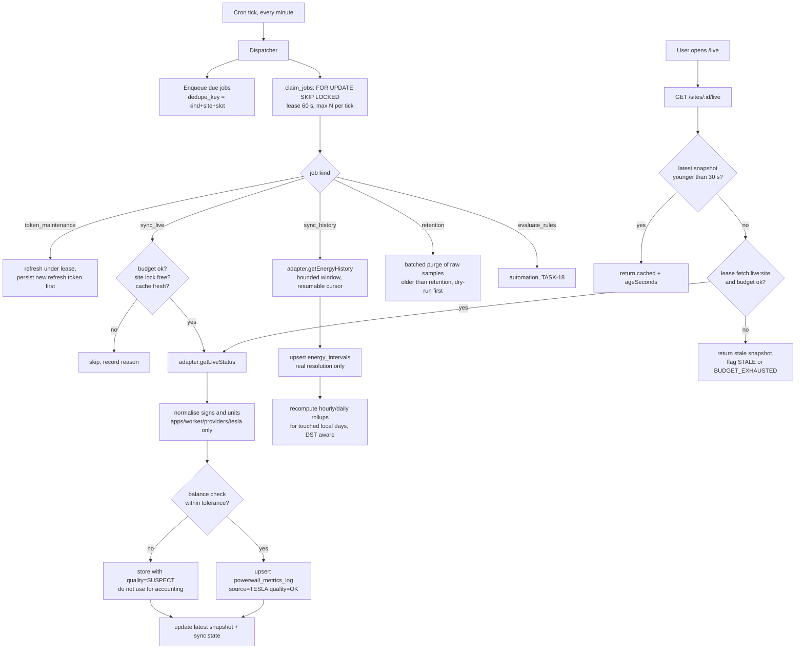
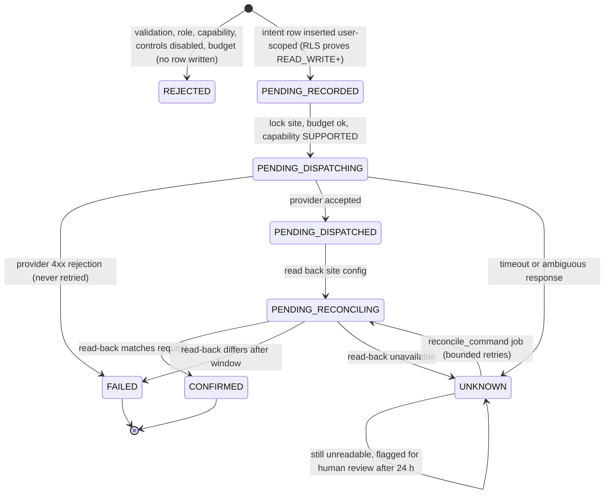

# System Architecture (TASK-01)

Status: **PROPOSED, awaiting owner approval** (see `docs/handoffs/TASK-01.md`). Written 2026-10-22.
Inputs: `docs/research/*` (TASK-00), `docs/ai-build-kit/02-PROJECT-CONTEXT.md`, `04-REPO-STRUCTURE.md`. Nothing here contradicts the TASK-00 findings. Items TASK-00 left `UNVERIFIED` stay `UNVERIFIED` and mock-only.

Decision IDs (D-004 …) refer to `docs/DECISIONS.md`. Open items refer to `docs/UNRESOLVED_QUESTIONS.md` (Q-xx).

## 1. Vendor facts used (verified 2026-10-22)

| ID | Source | Facts relied on |
|---|---|---|
| V1 | https://developers.cloudflare.com/workers/static-assets/ | A Worker can ship static assets with its code in one deployment. `assets.directory`, `assets.binding`, `assets.not_found_handling = "single-page-application"`, `assets.run_worker_first` (array of path patterns, `!` negation) are supported. By default a request matching an asset is served without invoking Worker code. |
| V2 | https://developers.cloudflare.com/workers/static-assets/migration-guides/migrate-from-pages/ | Compatibility matrix: Cron Triggers and full Durable Objects are supported on Workers, not on Pages (cron ❌, DO 🟡). `_headers` and `_redirects` are supported natively. Workers custom domains require Cloudflare-managed nameservers. Config file may be `wrangler.jsonc`, `wrangler.json` or `wrangler.toml`. |
| V3 | https://developers.cloudflare.com/workers/platform/limits/ | **Free:** CPU 10 ms per request and per cron invocation, 50 subrequests per request, 5 cron triggers per account, 100k requests/day. **Paid:** CPU default 30 s (max 5 min), cron CPU 30 s (interval under 1 h) or 15 min, subrequests 10,000. Memory 128 MB. Startup limit 1 s. Cron/DO-alarm/queue wall time 15 min. Zod must be 4.5.0 or later in Workers (memory). Log data per request 256 KB. |
| V4 | https://developers.cloudflare.com/workers/configuration/cron-triggers/ | Cron Triggers call a `scheduled()` handler, run on UTC, run on underutilised machines (no exact-time guarantee is stated), changes can take up to 15 minutes to propagate, 5-field expressions with `*/n` supported, the dashboard keeps only the last 100 invocations. |
| V5 | https://developers.cloudflare.com/durable-objects/what-are-durable-objects/ | Durable Objects are single-threaded with strongly consistent private storage, support Alarms, and can be globally addressed by name. |
| V6 | https://developers.cloudflare.com/workers/runtime-apis/web-crypto/ | Workers implements Web Crypto including AES-GCM (`encrypt`/`decrypt`/`generateKey`/`importKey`), HKDF, HMAC and the non-standard `timingSafeEqual`. |
| V7 | https://developers.cloudflare.com/workers/configuration/secrets/ | Secrets are set with `wrangler secret put` or the dashboard; local values go in `.dev.vars` or `.env` which must not be committed; `vars` must not hold sensitive values; a `secrets.required` list makes deploy fail if one is missing. |
| V8 | https://supabase.com/docs/guides/auth/jwts | Asymmetric JWTs can be verified locally against `https://<project>.supabase.co/auth/v1/.well-known/jwks.json` (example uses `jose`). The JWKS is cached by Supabase's edge for 10 minutes, applications must not cache longer. HS256 shared-secret verification is "strongly" discouraged; if HS256 is used, verify via `GET /auth/v1/user`, which is slow from the edge. Relevant claims: `iss`, `exp`, `sub`, `role`. `supabase.auth.getClaims()` is the library route for Supabase-issued JWTs. |
| V9 | https://supabase.com/docs/guides/auth/signing-keys | Asymmetric signing keys give fast local validation and automatic revocation via the discovery endpoint. Publishable and secret API keys are independent of the JWT signing key. Rotate at least yearly; wait at least token lifetime + margin before revoking a previous key. |
| V10 | https://supabase.com/docs/guides/database/postgres/row-level-security | `service_role` / secret key bypasses RLS and must stay server-side; a secret key bypasses RLS only when the request carries no user access token. With RLS on and no policies, a publishable key sees nothing. Views bypass RLS by default; `SECURITY DEFINER` functions run with the owner's privileges (owner `postgres` has `bypassrls`). |

Not verified from official pages in this task (marked where used): Workers paid-plan price, Supabase plan limits, exact `aud` claim of Supabase JWTs, Supabase `gen types` command syntax, whether a `.well-known` dot-directory is uploaded as a static asset.

## 2. Responsibilities (explicit separation)

| Layer | Owns | Must never |
|---|---|---|
| **Frontend** (`apps/web`) | Rendering, routing, forms, client-side validation for UX, charts, Canvas flow, permission-aware display (hide/disable), calling Supabase Auth (sign-in/up/out) and the Worker API. Uses `packages/domain` for display-side calculations (tariff, accounting) on data returned by the API. | Hold or see Tesla tokens or service credentials. Decide authorisation. Call Tesla. Write to the database directly for anything other than its own Supabase Auth session (no table access in v1). |
| **Worker** (`apps/worker`) | The only network path to Tesla and to privileged database operations. JWT verification, authoritative role lookup, input validation, rate limiting, command lifecycle, scheduling, ingestion, token encryption/decryption, audit writes. | Trust a role, household or site id supplied by the client. Return secrets. Use the service credential for ordinary user reads when a user-scoped call works. |
| **Database** (Supabase Postgres) | Final authority on authorisation (RLS), integrity (constraints, `source` check, last-admin rule, one-time bootstrap), atomic job claims and leases, append-only audit and command history. | Rely on the application for tenancy isolation. Store plaintext tokens or keys. |
| **Shared packages** | `packages/shared`: Zod schemas and types, constants, no logic or I/O. `packages/domain`: pure deterministic energy logic (normalisation, tariff, accounting) with injected clock. | `shared`/`domain` import apps; `domain` touch network, DB or `Date.now()`. |

## 3. System architecture diagram



Notes:
- **One deployed Worker** serves the SPA (static assets) and the API (D-021). Same origin means no CORS in production and no cross-site tokens. `run_worker_first` is limited to `/api/*` (and the Tesla callback under it); everything else is served as an asset with SPA fallback (V1). CORS allowlist exists for local dev and preview URLs only.
- A Worker invoked by cron and a Worker invoked by HTTP are the same code bundle (`scheduled` and `fetch` exports).
- `apps/web` and `apps/worker` stay separate workspaces (D-020). The Worker's Wrangler config lives in `apps/worker` and points `assets.directory` at the web build output.
- Static hosting choice (decision 5, D-008): Workers with static assets, not Pages. Evidence: V1 and V2 (Cron Triggers and Durable Objects unavailable or limited on Pages; Pages-to-Workers guide exists). The pages do not literally say "recommended"; that wording is `UNVERIFIED`, the choice rests on the feature matrix.
- Custom domain needs Cloudflare-managed nameservers (V2). The Tesla public key must be served from the registered domain (TASK-00 Q2), so the owner's domain must be on Cloudflare DNS or an alternative must be found (Q-03).

## 4. Authentication flow



Rules:
- JWT verification (decision 6, D-009): asymmetric signing keys, verify locally with `jose` against the project JWKS; reject HS256 and any `alg` not in an allowlist; require `exp`, `iss` equal to the configured project issuer, `sub` present, `role` = `authenticated`. `aud` is `UNVERIFIED` and is checked only after confirming the real claim in Task 14. If the project still uses the legacy shared secret the Worker refuses to start (health check fails) until the owner migrates signing keys (V9). The Worker does not cache the JWKS beyond 10 minutes (V8).
- Role and household are **never** read from JWT claims or request bodies for authorisation. The Worker loads membership from the database for `(sub, household)` on every request (D-004).
- Database calls for user data use a client carrying the user's JWT, so RLS is the second, independent check. The secret key is used only in the cases listed in `SECURITY_MODEL.md` §6.
- Session storage in the browser is supabase-js default (local storage). Mitigation: strict CSP and no third-party scripts, delivered via the assets `_headers` file (V2). XSS risk is recorded in `KNOWN_LIMITATIONS.md`.
- Sign-up: public sign-up creates a profile with no household and no role, so the user sees nothing until invited (D-005). Email confirmation is required (Supabase project setting, to be verified in Task 07).

## 5. Tesla OAuth flow

```mermaid
sequenceDiagram
  autonumber
  participant A as ADMIN browser
  participant W as Worker
  participant D as Postgres
  participant T as auth.tesla.com / fleet-auth
  participant F as Fleet API (regional)
  A->>W: POST /api/v1/sites/connect/tesla/start (Bearer JWT)
  W->>W: require ADMIN of household (DB lookup)
  W->>D: insert oauth_state (hash of random state, PKCE verifier encrypted, household, user, expires 10 min)
  W-->>A: authorize URL (response_type=code, client_id, redirect_uri, scope, state, code_challenge)
  A->>T: user signs in to Tesla and consents to scopes
  T-->>A: redirect to /api/v1/provider/tesla/callback?code&state
  A->>W: GET callback (no Bearer; browser navigation)
  W->>D: consume state (single use, unexpired, bound to household and user)
  W->>T: POST /oauth2/v3/token (authorization_code, client secret, audience = configured base URL)
  T-->>W: access_token, refresh_token (single use, 3 months)
  W->>F: GET /api/1/users/region (sanity check vs configured base URL)
  W->>W: encrypt tokens (AES-GCM, key id, AAD = household+provider)
  W->>D: upsert tesla_credentials (ciphertext only)
  W->>F: GET /api/1/products (list energy sites)
  W-->>A: 302 to /settings?provider=tesla&step=choose-site
  A->>W: POST /sites (choose one energy_site_id) (ADMIN)
  W->>D: insert energy_sites (provider TESLA)
```

Constraints from TASK-00:
- Token exchange uses `https://fleet-auth.prd.vn.cloud.tesla.com/oauth2/v3/token` and a Fleet API base URL as `audience`. The EU base URL is `UNVERIFIED`, so it is a required configuration value `TESLA_FLEET_API_BASE_URL` set by the owner (Q-02). After the first token the Worker calls `GET /api/1/users/region` and refuses to continue if it disagrees with the configured value.
- PKCE: the OAuth metadata lists S256 (TASK-00 S16) but whether it is required is `UNVERIFIED`; the design sends S256 and keeps the client secret, so it works either way.
- The callback cannot carry a Bearer header (browser navigation). It is protected by the single-use, short-lived, user- and household-bound `state`, not by session. The callback never returns tokens to the browser.
- Refresh tokens are single-use and rotate (TASK-00 Q3). Refresh is serialised per credential with a database lease (§7) and the new token is persisted **before** the access token is used. The 24-hour grace window for the previous refresh token is a safety net only.
- Refresh tokens expire after 3 months. A `token_maintenance` job exercises the refresh chain at least every 7 days so an idle site does not lose access. If refresh fails with `login_required`, the credential becomes `NEEDS_REAUTH` and ADMINs see a banner.
- Scopes requested: `openid offline_access energy_device_data`, plus `energy_cmds` only when an ADMIN explicitly enables controls (D-006 additional note).

## 6. Telemetry ingestion flow



Principles:
- **Resolution honesty (rule 9):** `powerwall_metrics_log` stores whatever snapshots were actually polled (cadence is cost-limited). `energy_intervals` stores provider-reported Wh at the resolution Tesla returns (`UNVERIFIED` until observed). Accounting prefers `energy_intervals` and only falls back to integrating power snapshots with a lower-quality flag (D-022).
- **Cost control (TASK-00 Q9):** every outbound Tesla call first increments a counter in `provider_usage_daily` through an atomic database function. Default monthly estimated spend cap is **USD 9.00** (below the USD 10 discount; costs from published rates, billing category `UNVERIFIED`), configured as `TESLA_MONTHLY_SPEND_CAP_USD` (D-023). Defaults: background live snapshot every 30 minutes (≈1,440 requests/month), on-demand live view at most once per 30 s per site with a monthly on-demand allowance of 2,000, history sync daily (≈90 requests/month): ≈3,530 Data requests ≈ USD 7.06 at USD 0.002 each. Warning at 80 % of the cap, hard stop at 100 %. 4xx responses count (TASK-00 Q8) and are never retried in a loop.
- **Failure isolation:** each job processes one site; failure marks that job, not the batch.
- **Late and duplicate data:** upserts keyed by `(site_id, sampled_at)` and `(site_id, interval_start, resolution_seconds)`; rollups for touched days are recomputed from source rows, never incremented.

## 7. Locking and scheduling on Workers (decision 4, D-007)

**Choice: Postgres job table with atomic claim and leases. No Durable Objects in v1.**

Alternatives:
| Option | For | Against |
|---|---|---|
| Postgres `scheduled_jobs` + `job_locks` with `FOR UPDATE SKIP LOCKED` (chosen) | One source of truth next to the data; works identically for cron and HTTP callers; no new platform concept; free-plan compatible; testable in pgTAP and with a fake clock; leases survive Worker restarts. | Each claim costs a subrequest (counts against the 50/request free limit, V3); polling cost every tick; correctness depends on well-written SQL functions. |
| Durable Objects per site (V5) | Single-threaded per site, alarms, strong consistency, no DB round trip for locks. | Second state store to keep consistent with Postgres; separate deployment/migration lifecycle; alarms and storage behaviour must be verified and tested; tests need Workers runtime; more moving parts for a small single-household app. |
| In-memory locks in the Worker | Trivial | Invalid: no shared memory across isolates (explicitly a problem in the kit review item 10). |

Mechanics:
- Cron fires every minute (`* * * * *`). V4 does not promise exact timing and changes take up to 15 minutes to propagate. The design assumes jitter, skipped ticks and duplicate delivery: every job is idempotent, keyed by `dedupe_key` (kind + site + slot start), and carries `run_at`, `attempts`, `max_attempts`, `lease_expires_at`.
- `claim_jobs(worker_id, max, lease_seconds)` is a `SECURITY DEFINER` function callable only by the service role. It selects due, unleased (or lease-expired) jobs `FOR UPDATE SKIP LOCKED`, marks them `RUNNING`, sets the lease and returns them. A lease expiry makes a crashed job claimable again.
- `job_locks(key, owner, lease_expires_at)` provides named short leases (`token:<credential>`, `fetch:live:<site>`) via `acquire_lock`/`release_lock` functions. Acquire is a single `INSERT … ON CONFLICT … WHERE lease_expires_at < now()` statement.
- Missed ticks: jobs carry the slot they were meant for. History sync is cursor-based so a missed tick is caught up by the next run. Automation (TASK-18) has its own bounded recovery window; older misses are skipped and logged.
- **Free-plan limits (V3):** CPU 10 ms and 50 subrequests per invocation. Each tick therefore claims a small bounded batch (default 3 jobs) and avoids CPU-heavy work (no large JSON or decimal loops in one invocation; rollups are chunked by day). Whether the free plan is sufficient is **unverified until measured in Task 14/16**. The fallback is the Workers Paid plan, whose price is not verified here and which affects the subscription-free goal (Q-05, D-024).
- Zod in the Worker must be 4.5.0 or later (V3 memory note). Task 02 pins it.

## 8. Credentials storage (decision 3, D-006)

| Secret | Where | Who can read |
|---|---|---|
| Tesla client ID/secret | Cloudflare Worker secrets (client ID may be a plain var; secret is a secret) | Worker code only |
| Supabase secret key (service access) | Cloudflare Worker secret `SUPABASE_SECRET_KEY` | Worker code only; never in the frontend bundle, never `VITE_*` |
| `TOKEN_ENCRYPTION_KEY` (and `TOKEN_ENCRYPTION_KEY_PREVIOUS` during rotation) | Cloudflare Worker secrets | Worker code only |
| Tesla access/refresh tokens | Postgres table `tesla_credentials`, AES-256-GCM ciphertext | Only the Worker, via the secret key, after decrypting with `TOKEN_ENCRYPTION_KEY`. No grants to `anon` or `authenticated`; RLS on with no policies. |
| Tesla partner private key (for key-pairing / signing, if ever needed) | Owner's secret store, not in the repo; only added to the Worker if signing for energy products is verified as necessary | n/a for v1 |
| User JWTs | Browser session (Supabase Auth) | The user; never logged |

Encryption scheme: AES-256-GCM through Web Crypto (V6). A random 96-bit nonce per encryption. Additional authenticated data = `household_id | provider | credential_id | key_id`, so a ciphertext cannot be moved to another row. Row stores `key_id`, `nonce`, `ciphertext`, `version`. Plaintext exists only in Worker memory for the duration of a call and is never logged.

Rotation: keep the old key as `TOKEN_ENCRYPTION_KEY_PREVIOUS`, deploy the new `TOKEN_ENCRYPTION_KEY`, run `reencrypt_credentials` (rewrites rows whose `key_id` is old, under the credential lease), then remove the previous key. Supabase signing keys rotate at least yearly (V9). Tesla client secret rotation is done in the Tesla portal and the Worker secret.

A database administrator (platform operator) can read ciphertext but cannot decrypt it without the Cloudflare secret. Compromise of one of the two stores alone does not reveal tokens.

## 9. Demo versus live separation (decision 14, D-017)

- DEMO data is **never persisted**. The demo provider (`packages/domain` fixtures + `apps/worker/providers/demo`) generates deterministic synthetic readings on demand, every reading carries `source: "DEMO"`, and the UI shows a persistent DEMO banner.
- Types: `TelemetryReading` is a discriminated union on `source` (`DEMO | TESLA | MOCK`). Accounting/rollup functions accept only `LiveTelemetry` (`source: "TESLA"`), so passing DEMO is a compile error. A runtime Zod guard rejects it too.
- Database: `powerwall_metrics_log.source` has `CHECK (source = 'TESLA')`; `energy_intervals.source` likewise; `energy_sites.provider` has `CHECK (provider IN ('TESLA'))` (the Tesla **mock adapter** exists for tests and local development only: it runs against a disposable local database, and the Worker refuses to start with `PROVIDER_MODE=mock` when `ENVIRONMENT=production`). Any attempted `DEMO` insert fails (TASK-03/04 tests).
- Site state machine for the UI: `DEMO → CONNECTING → LIVE / STALE / ERROR` (TASK-16). Demo and live are never rendered in the same chart.

## 10. Route and feature map (see also §12 for command lifecycle)

See `docs/PRODUCT_REQUIREMENTS.md` §5 for the route inventory and `docs/API_CONTRACT.md` for endpoints.

## 11. Polling and billing defaults (summary; D-023)

| Setting | Default | Where configured |
|---|---|---|
| Monthly estimated Tesla spend cap | USD 9.00 | `household_settings.monthly_spend_cap_usd` (ADMIN) |
| Background live snapshot interval | 30 minutes | `household_settings.live_background_interval_minutes` |
| On-demand live refresh minimum interval | 30 seconds per site | `household_settings.live_on_demand_min_interval_seconds` |
| On-demand monthly allowance | 2,000 requests | `household_settings.on_demand_monthly_allowance` |
| History sync | daily, resumable | job schedule |
| Token maintenance | at least every 7 days | job schedule |
| Staleness threshold | 3,600 s (must exceed background interval) | `household_settings.stale_after_seconds` |
Estimated load: about 1,440 + 2,000 + 90 = 3,530 Data requests per month, about USD 7.06 at the published USD 0.002 each (billing category of the energy endpoints is `UNVERIFIED`; arithmetic in `docs/research/TESLA_FEASIBILITY.md` Q9). The owner still sets Tesla's own billing limit (default 0) in the Tesla portal.

## 12. Command lifecycle (decision 12, D-015)

States are the honest set from rule 4: `PENDING`, `CONFIRMED`, `FAILED`, `UNKNOWN`. `phase` records progress inside `PENDING`/`UNKNOWN`. A command is a **configuration change request**; `CONFIRMED` means the provider's read-back shows the requested configuration, not that a physical outcome is guaranteed.



Rules:
- **Intent first:** the `device_command_log` row (`PENDING`, `RECORDED`) is written before any provider call, with `idempotency_key` and `params_hash`. A duplicate key with the same hash returns the stored command; with a different hash returns 409.
- **Dispatch guards (backend, independent of the UI):** caller is READ_WRITE+ (DB-proven), site belongs to the household, capability is `SUPPORTED` in the registry (only `DOCUMENTED` and payload-verified kinds; otherwise `UNVERIFIED` and rejected), `controls_enabled` is true and the scope was granted, parameters pass the safety limits (for example reserve range and step), site lock `command:<site>` acquired, spend budget available, per-household command rate limit.
- **No blind retries:** a 4xx rejection is final (`FAILED`, billed). A timeout is `UNKNOWN`, never `FAILED` and never retried by re-sending; the state is read back first. Commands that are not idempotent in effect are not auto-resent.
- **Reconciliation:** read back `site_info` (budgeted), compare with `params`; match → `CONFIRMED`; mismatch after the window → `FAILED`; unreadable → `UNKNOWN` and a `reconcile_command` job retries with backoff.
- **Every transition** appends a `device_command_events` row and an audit entry; the UI never shows success without `CONFIRMED`.
- **Automation-originated commands** use the same path (origin `AUTOMATION`), are blocked by the global pause, and carry an idempotency key derived from `(rule_id, site_id, scheduled_slot)`. Dry-run never reaches this path.
- Until the owner has verified live behaviour by hand, `provider_mode = MOCK` (D-006, D-003).

## 13. Cross-document consistency anchors

- **Roles:** `READ_ONLY | READ_WRITE | ADMIN`, per household membership, defined once in `SECURITY_MODEL.md` §2.
- **Units and signs:** defined once in `ENERGY_ACCOUNTING.md` §2 (ratified from `02-PROJECT-CONTEXT.md` rule 6).
- **Credentials:** defined once in §8 above; `SECURITY_MODEL.md` §5 points here.
- **Money:** defined once in `ENERGY_ACCOUNTING.md` §7.
