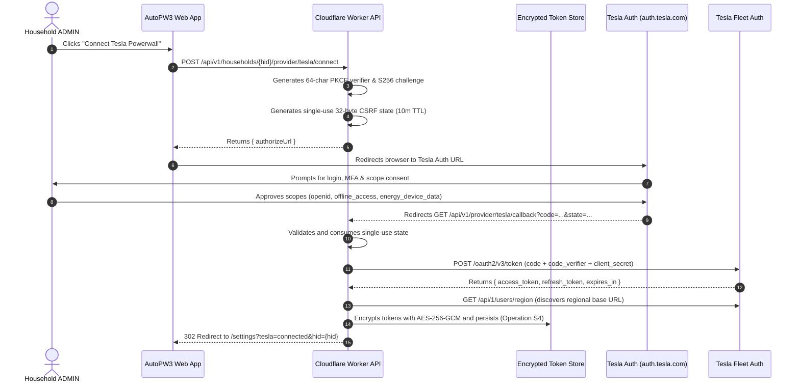

# Tesla Fleet API Integration Manual — AutoPW3

This document details the server-side integration between AutoPW3 and the Tesla Fleet API for residential energy sites (Powerwall).

---

## 1. Architectural Principles & Security Boundary

1. **Server-Side Only**: All Tesla Fleet API communication occurs exclusively within Cloudflare Workers (`apps/worker`). The browser never sees or handles Tesla access tokens, refresh tokens, or client secrets.
2. **Authenticated Encryption at Rest (Operation S4)**: Tokens are stored encrypted in the database using AES-256-GCM with per-record 96-bit random IVs and key versioning.
3. **No Invented Provider Behavior**: Endpoints and capability claims strictly reflect documented vendor behavior (`docs/research/TESLA_FEASIBILITY.md`). Where official documentation is absent, capabilities are designated `UNVERIFIED` and backed by `MockTeslaClient`.
4. **Budget & Rate-Limit Awareness**: Tesla calls are rate-limited to 60 requests/minute per device. Ingestion and telemetry retrieval adhere to on-demand budgets and cached snapshots.

---

## 2. OAuth 2.0 Authorization Code Flow with PKCE

AutoPW3 connects to Tesla user accounts using the Third-Party Token Authorization Code grant with PKCE (Proof Key for Code Exchange) per RFC 7636.

### Scopes
- `openid`: Standard identity profile.
- `offline_access`: Grants a 3-month rotating refresh token.
- `energy_device_data`: Grants read access to site information, live status, and historical telemetry.
- `energy_cmds`: Requested only when `enableControls: true` is explicitly chosen by an ADMIN (D-006).

---

## 3. Refresh Token Rotation & Concurrency Guard

### Rotating Refresh Tokens
Tesla refresh tokens are **single-use** and expire after **3 months**. Every token exchange returns a brand-new refresh token that invalidates the previous one. To tolerate network dropouts, Tesla provides a 24-hour grace window for the immediate predecessor, but concurrent refresh attempts from parallel Worker executions will result in `401 login_required` and account disconnection.

### Concurrency Lock
To eliminate race conditions:
1. Before requesting a token refresh, the Worker acquires an atomic lock `acquireRefreshLock(siteId, 15000)`.
2. Concurrent Worker requests encounter the active lock and wait or return cached telemetry.
3. The new access and refresh tokens are encrypted and committed to the store **before** the lock is released.

---

## 4. Regional Base URL Discovery

Tesla operates geographically segregated Fleet API clusters (North America, Europe, Asia-Pacific). The EU base URL is not statically hardcoded; instead, the Worker discovers it dynamically:
1. Upon code exchange, the Worker queries `GET https://fleet-api.prd.na.vn.cloud.tesla.com/api/1/users/region`.
2. The response provides `{ region: "eu", fleet_api_base_url: "https://fleet-api.prd.eu.vn.cloud.tesla.com" }`.
3. The discovered `fleetApiBaseUrl` is stored alongside the encrypted credentials and used for all subsequent device calls for that site.

---

## 5. Telemetry Normalisation & Central Sign Conventions

Vendor field names and raw readings are transformed into AutoPW3's central sign conventions (`packages/domain/src/telemetry/normalise.ts`):

| Physical Measurement | Tesla Native Field | Native Convention | AutoPW3 Central Convention | Transformation |
|---|---|---|---|---|
| **Solar Power** | `solar_power` | Watts ($\ge 0$) | $\ge 0$ | `Math.max(0, raw.solar_power)` |
| **Battery Power** | `battery_power` | Watts ($< 0$ discharging, $> 0$ charging) | $> 0$ discharging, $< 0$ charging | `-raw.battery_power` |
| **Grid Power** | `grid_power` | Watts ($> 0$ import, $< 0$ export) | $> 0$ import, $< 0$ export | `raw.grid_power` |
| **Home Load** | `load_power` | Watts ($\ge 0$) | $\ge 0$ | `Math.max(0, raw.load_power)` |
| **Battery SoC** | `percentage_charged` | Percent (0–100) | Percent (0–100) | Clamped `[0, 100]` |

Missing fields are normalised to `null` (never 0) and flagged as `PARTIAL` in accordance with project rules 8 and 9.

---

## 6. Error Taxonomy & Rate Limiting

- **HTTP 401 Unauthorized**: Mapped to `TeslaAuthError`. Indicates token expiration or user password reset. Sets site connection state to `NEEDS_REAUTH`.
- **HTTP 429 Too Many Requests**: Mapped to `TeslaRateLimitError`. Reads the `Retry-After` response header and backs off accordingly.
- **HTTP 5xx Server Errors**: Mapped to `TeslaApiError`. Does not retry 4xx errors in a loop.
- **Network Failures**: Mapped to `TeslaNetworkError`.

---

## 7. Manual Prerequisites for Live Tesla Fleet API Access

To transition from `MockTeslaClient` to live hardware integration:
1. **Developer Account**: Register at [developer.tesla.com](https://developer.tesla.com) with an MFA-enabled Tesla account.
2. **Application Registration**: Submit app name, description, and OAuth redirect URI (`https://<domain>/api/v1/provider/tesla/callback`).
3. **Partner Key Hosting**: Generate an EC P-256 keypair; host public key at `https://<domain>/.well-known/appspecific/com.tesla.3p.public-key.pem`.
4. **Regional Partner Registration**: Call `POST /api/1/partner_accounts` on regional endpoints using partner client credentials.
5. **Secrets Configuration**: Set `TESLA_CLIENT_ID`, `TESLA_CLIENT_SECRET`, and `TOKEN_ENCRYPTION_KEY` in Cloudflare Worker secrets.
